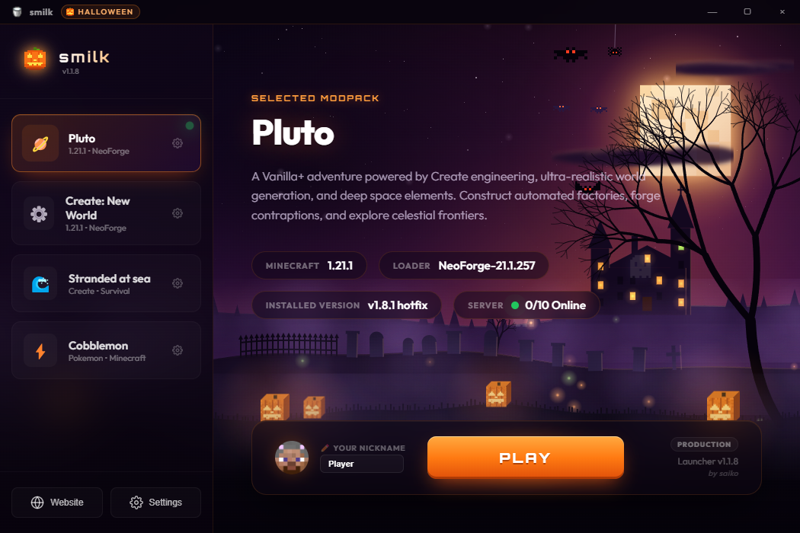
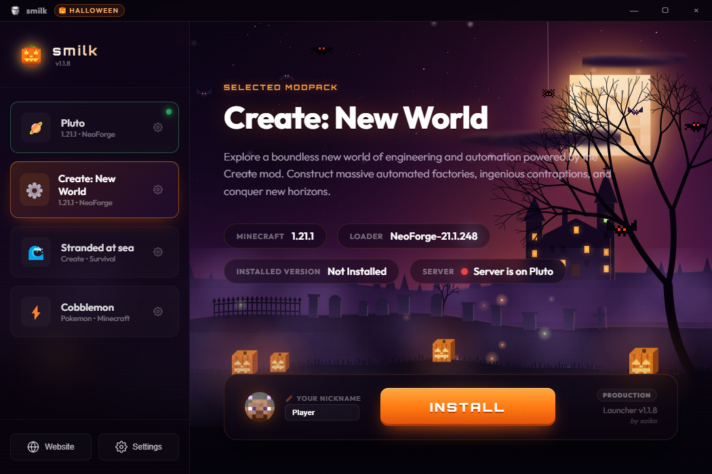
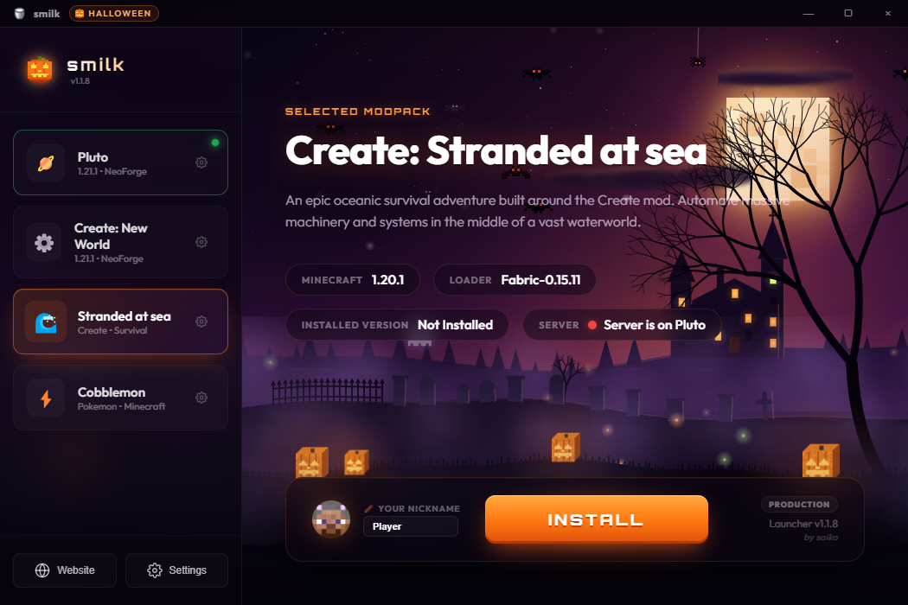
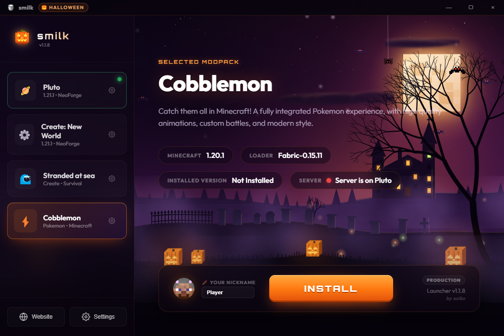
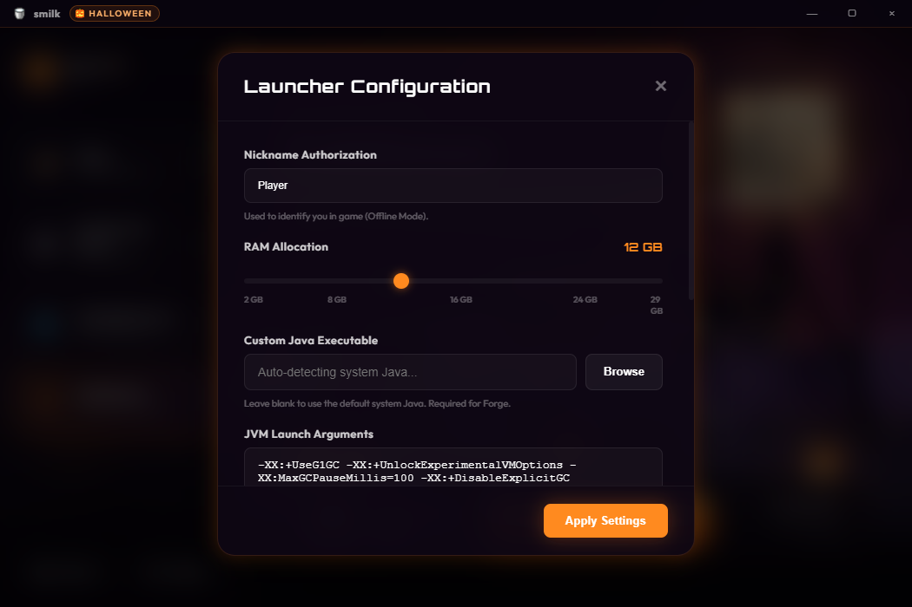

# smilk launcher 🥛🧊

[](#)
[](https://electronjs.org/)
[](https://nodejs.org/)
[](https://minecraft.net/)
[](#)

A custom, premium Minecraft launcher built with **Electron**, **Node.js**, and **minecraft-launcher-core**. Designed with a sleek modern UI, glassmorphic layout, dynamic pixel-art & 2.5D seasonal animations, automated modpack management via `.mrpack` (Modrinth / Git LFS), and cross-platform support for Windows and Linux.

---

## 🎨 Themes & Visuals

The launcher features custom interactive visual scenes that dynamically adapt to the selected modpack and seasonal events.

| 🎃 Pluto (Halloween Spooky Edition) | ⚙️ Create: New World |
| :---: | :---: |
|  |  |

| 🌊 Create: Stranded at Sea | 🦁 Cobblemon |
| :---: | :---: |
|  |  |

| 🔧 Launcher Configuration & Settings |
| :---: |
|  |

---

## ✨ Features

- **🎃 Seasonal Halloween Engine**: 
  - Dynamic 2.5D atmospheric canvas scene featuring moonlit haunted manors, fluttering bats with sinusoidal kinematics, translucent glowing ghosts, creeping ground fog mist, and will-o'-the-wisp embers.
  - Spooky UI styling: Carved Jack-o'-Lantern bucket logo with candle-flicker animation, fiery magma PLAY button with ember pulse micro-animation, and corner spiderwebs.
  - Automatic seasonal detection (Oct 15 – Nov 5) with manual override toggle in settings.
- **🪐 Pluto & Modern Modpack Support**: 
  - Full support for Minecraft 1.21.1 (NeoForge 21.1.257 / Fabric 0.15.11) with native Iris and Oculus shaders support.
  - Pre-configured community multiplayer server list (`servers.dat`) and synchronized game settings (`options.txt`).
- **🛡️ Modpack Integrity & Missing Mods Guard**:
  - Real-time pre-flight verification checks the integrity of `mods/` and manifests before launch.
  - Automatically detects deleted or missing mods and prompts to restore them with a single click (`RESTORE & PLAY`), preventing crashes from accidentally missing files.
- **⚡ Zero-Rate-Limit Dynamic Branch Resolution**:
  - Dynamically discovers `.mrpack` files on any GitHub branch without hardcoded filenames.
  - Bypasses GitHub API rate-limiting (60 req/hr) by leveraging CDN tree scanning and Atom feeds.
  - Direct binary downloads for large modpacks tracked with Git LFS (`media.githubusercontent.com`).
- **🎮 Cross-Platform Dedicated GPU**:
  - Enforces high-performance discrete GPU (NVIDIA / AMD) on Windows (via DirectX `UserGpuPreferences`) and Linux (via PRIME Render Offload & Vulkan device selection).
- **🛠️ Profile Verification & Repair**:
  - In-app "Verify & Repair" checks vanilla `client.jar`, asset indexes, sound libraries, and modpack files against official SHA-1 checksums without overwriting personal configs.
- **🐧 Linux First-Class Packaging**:
  - Native standalone `AppImage` for universal Linux support.
  - Native `RPM` packages for Fedora, RHEL, and openSUSE.
- **👤 Automatic Minecraft Avatars**: Real-time 2D face rendering fetched dynamically based on nickname, with automatic Steve/Alex offline fallback.
- **🎧 Discord Rich Presence**: Displays active modpack, player nickname, elapsed game time, and seasonal status.

---

## 🛠️ Tech Stack

- **Frontend**: HTML5, Vanilla CSS3 (glassmorphic design system, CSS variables), JavaScript (ESNext).
- **Backend**: Electron (Main process with IPC isolation), Node.js.
- **Core Engine**: `minecraft-launcher-core` (MCLC).
- **Modpack Handling**: `adm-zip` for manifest parsing and mod archive extraction.

---

## 🚀 Running Locally

### Prerequisites
- [Node.js](https://nodejs.org/) (v20 or newer recommended)
- Java Runtime (Adoptium Eclipse Temurin JDK 17/21/22 for modern Minecraft versions; the launcher also features automatic Java installation)

### Setup
1. Clone the repository:
   ```bash
   git clone https://github.com/Saiko6540/smilk-launcher.git
   cd smilk-launcher
   ```

2. Install dependencies:
   ```bash
   npm install
   ```

3. Run in development mode:
   ```bash
   npm start
   ```

---

## 📦 Building for Production

### Windows (.exe):
```bash
npm run build:win
```

### Linux (AppImage, RPM, tar.gz):
```bash
# Build all Linux targets:
npm run build:linux

# Build specific package format:
npm run build:rpm       # Native package for Fedora / RHEL
npm run build:appimage  # Universal standalone executable
```

Compiled production artifacts are generated in the `dist/` directory.

---

*Created with ❤️ by [Saiko](https://github.com/Saiko6540)*

